<div align="center">

# 🎯 Job Application Tracker

**A self-hosted job application tracker for software engineers.<br>
No account. No cloud. No AI. No tracking.**

Kanban board, recruiter CRM, interview rounds, follow-up reminders, offers side by side and a
Sankey diagram of your whole search. Your data lives in a folder on your own disk, with
optional automatic git backups.

[](https://waddington.github.io/job-application-tracker/)
[](LICENSE)


🔒 Runs on localhost · 🗂️ SQLite + plain-text JSONL and Markdown · 🔁 Automatic git snapshots · 📦 Apache-2.0

**[🌐 Website](https://waddington.github.io/job-application-tracker/) · [📖 User guide](docs/guide/README.md) · [🚀 Get started](#-getting-started) · [🤝 Contributing](CONTRIBUTING.md)**

⭐ **If you'd rather your job search didn't live in someone else's cloud, star the repo. It
helps other people find it.**

</div>

---

## What is it?

**Job Application Tracker** is an open-source, self-hosted web app for managing a job search.
It runs on your own machine and keeps your data in a folder you control. It's built for the
way tech hiring actually works:

- 🧑‍💼 **Recruiters send you several roles.** Track every recruiter and agency, their contact
  details and your calls with them. Note the roles they pitch, then apply, mark interested or
  pass on each one, and see every role they've put you forward for.
- 🔀 **Applications have messy, multi-stage processes.** Screen → tech interview → take-home
  → final → offer. Stages are configurable, and every change is timestamped.
- 📝 **The details are scattered everywhere.** Notes on calls, interviews and roles, Google
  Doc links, PDFs, exported emails, and the exact CV and cover letter you sent: all in one
  place.
- ⏰ **Things go quiet.** The *Today* home page sorts it all by what you do about it: *your
  move* (replies to read, follow-ups due, your to-dos), what's *coming up*, and who you're
  *waiting on*, including applications that have stalled. A *Timeline* shows everything that happened, across every company and person.
- 📊 **You want to know what's working.** A Sankey diagram shows where applications go, with
  conversion and time per stage, direct vs recruiter outcomes and a scorecard for every
  recruiter and agency.

## 🔒 Yours, and only yours

- **No account, no cloud.** It runs on `localhost`. There's nothing to sign up for and no
  server of ours your data goes to.
- **No AI.** Nothing reads, summarises, scores or uploads your notes, CVs or emails.
- **No tracking.** No telemetry and no analytics. The app never sends email, never contacts
  anyone and never calls out to the web.
- **Your files, in open formats.** One folder outside the code: a SQLite database plus a
  plain-text export (JSON Lines and Markdown notes) you can read without the app.
- **Simple backups.** Make the folder a git repo and every change is snapshotted
  automatically; `jat push` sends it to your own private remote. Or download a single zip.
- **No scraping.** It tracks the applications *you* make; it's not a job-search engine.

## 📸 Screenshots

*All names and companies below are made-up demo data (`scripts/seed_demo.py`).*

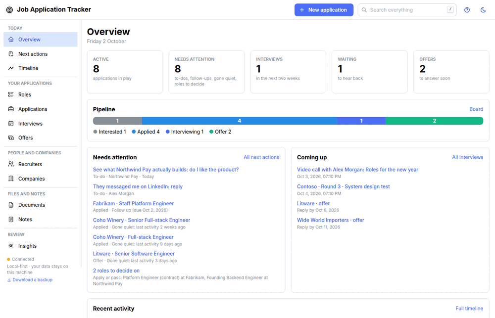

**Today, the home page.** Everything that needs you, sorted by what you do about it: **Your
move** (replies to read, offers to answer, how did it go?, to-dos, follow-ups, roles to
decide), **Coming up** (interviews, calls and dated to-dos) and **Waiting on them** (who
you're waiting to hear back from, and what's gone quiet), under one line of numbers and the
pipeline. Each item is a tile, and most keep their buttons faint until you point at them.

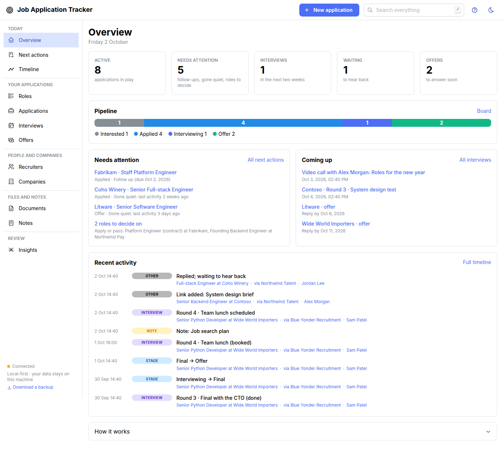

**Kanban board.** Drag applications between stages, see who's gone quiet (red) and which
interview round each one is at.

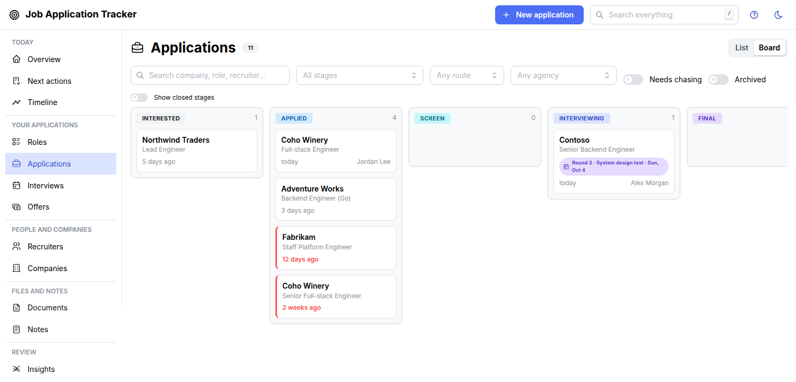

**Insights: the whole picture.** One Sankey diagram of every role, from where it came from
(through a recruiter, a referral, or you found it) to passing on it, deciding, or applying and
how far it got, with what's still waiting just after each stage: deciding whether to apply,
waiting to hear back, still interviewing, deciding on an offer. A second tab follows just
applications, filtered by route. Date range and counts on hover for both.


<details>
<summary><b>More screenshots</b>: who you're waiting on, a recruiter's page, roles, the Timeline, an application, insights, CVs compared, offers and search</summary>

**Waiting on them.** Who you've replied to and are waiting on (red once it's been longer than
the stage allows, with how long each person usually takes), and applications that have gone
quiet. Heard back, follow up, snooze or mark Ghosted in one click.

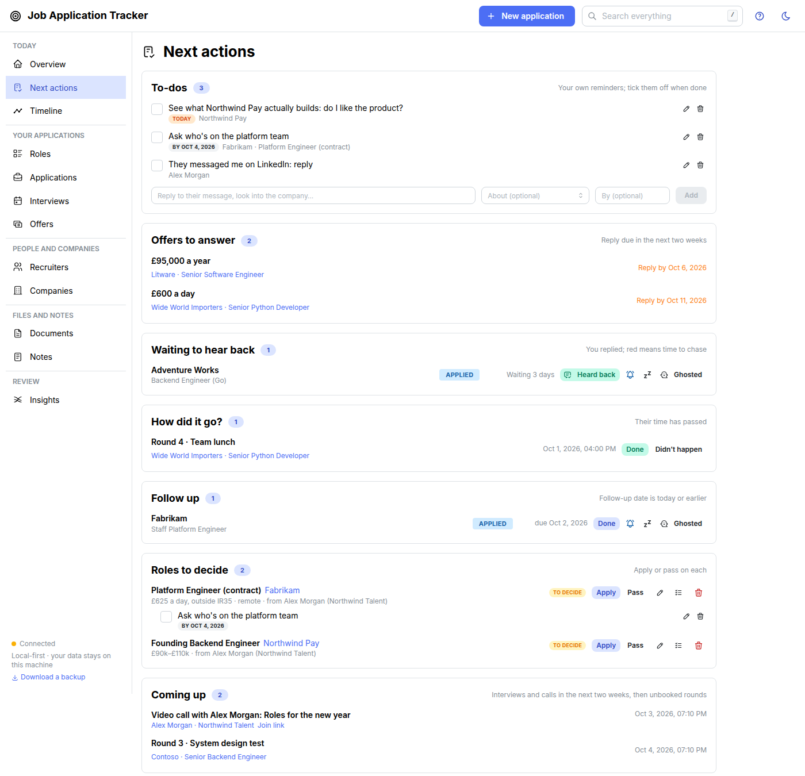

**Recruiters, their calls and the roles they pitch.** Book a call with an agenda, note how it
went, add the roles they mentioned, then apply, mark interested or pass on each. Every person has a page
like this, and its **Timeline** button shows their calls, pitches, applications and notes over time.

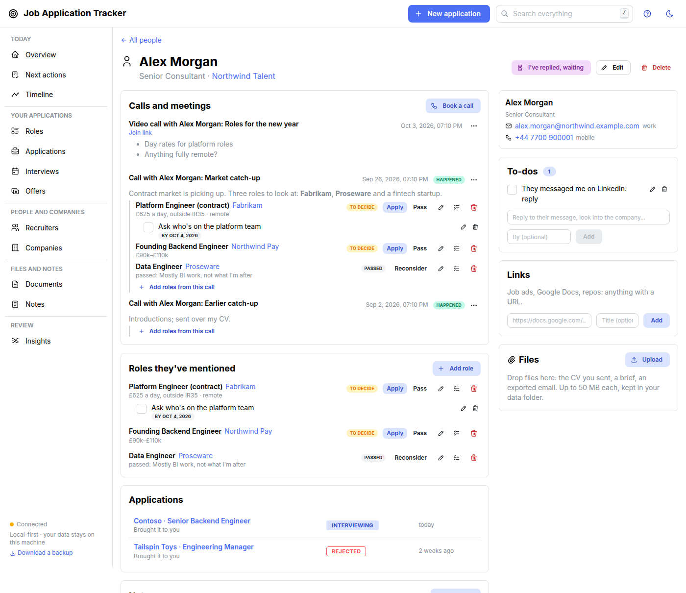

**Roles to decide.** Everything you might go for, before you apply. **Apply** makes the
application through whoever pitched it; **Interested** tracks it without applying yet; **Pass**
keeps your reason. Each role has its own page:
drop the job description on it and it follows the role onto your application.

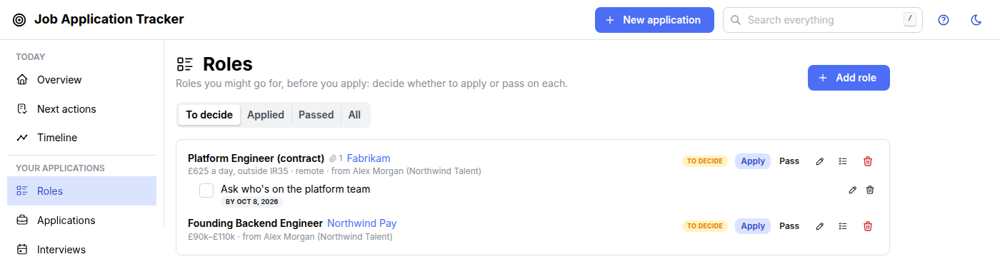

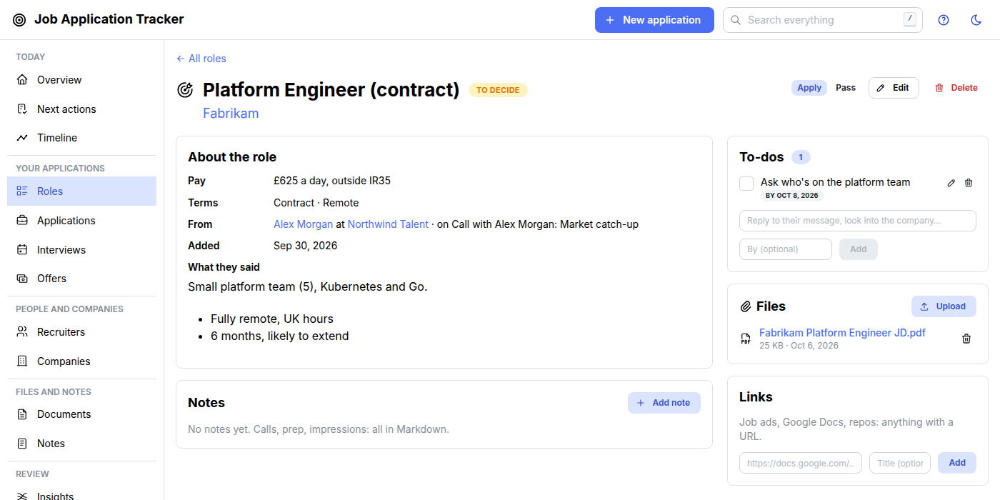

**Timeline of everything.** Calls, roles pitched and passed, stage moves, messages,
interviews, offers and notes, as a list by day or as lanes against time: one row per role, so
each one reads from the call it came up on to its outcome.

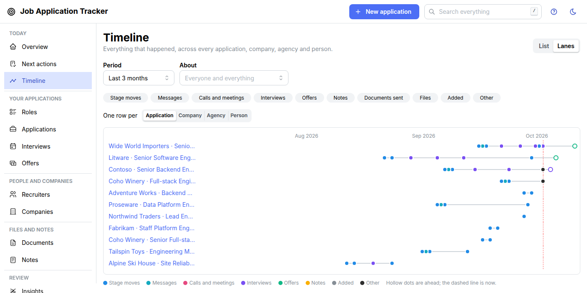

**Everything about an application in one place.** *At a glance* says what it needs and
how long ago things happened ("Gone quiet: no activity for 12 days", "Applied 3 weeks ago").
Below that: interview rounds in your own words ("Round 3 · System design test"), the CV
version you sent, Markdown notes, links, files and exported emails, and the full timestamped
history.

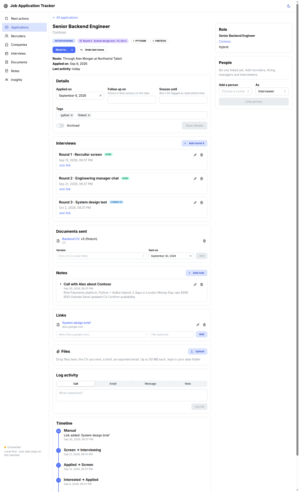

**Conversion, time in stage, direct vs recruiter, and a recruiter scorecard.** Which stages
you get stuck at, whether agencies or direct applications do better for you, and which
recruiters send roles that go somewhere.

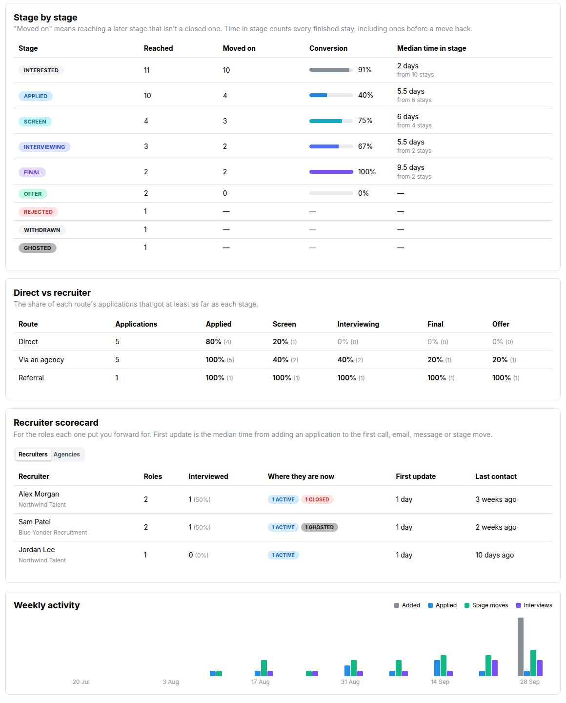

**Recruiter conversations: what happens before an application.** Calls held, the roles each
recruiter pitched, which you applied for or passed on (and why), and where the applications
went, as numbers, a Sankey diagram and a table per person or agency.


**Which CV works best?** An A/B test of your CV and cover-letter versions: how many heard
back, got a screen or interview, or an offer, with how sure each number is. Pick two to
compare and it tells you whether the gap is likely real or could be chance. Attached your CV
to applications, roles or recruiters as plain files? It spots identical ones and turns each into a version.


<table>
<tr>
<td width="50%"><b>Applications list</b> with filters, route, stage, round and staleness<br>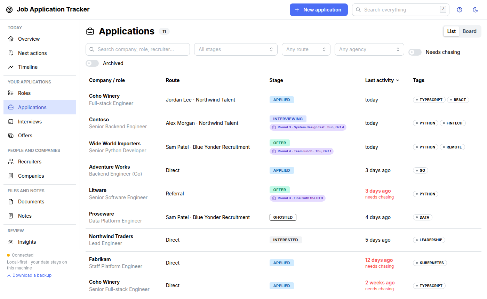</td>
<td width="50%"><b>Recruiter CRM</b>: agencies, recruiters and every way to reach them<br>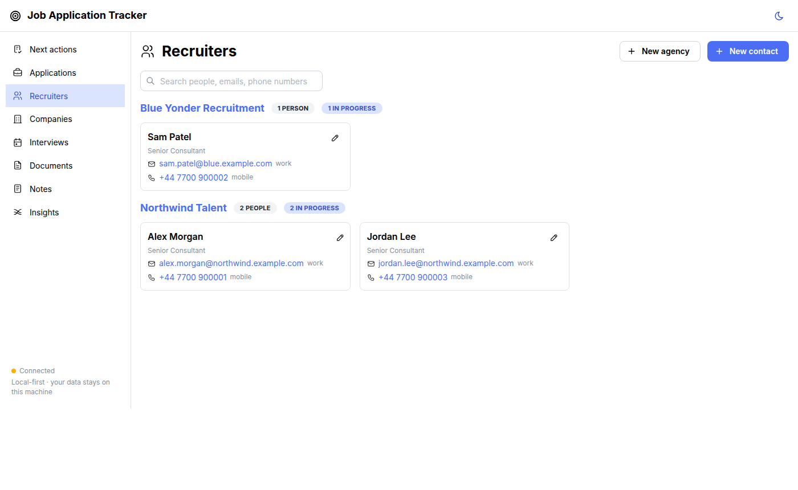</td>
</tr>
<tr>
<td width="50%"><b>CV and cover-letter versions</b>, and where each one was sent<br>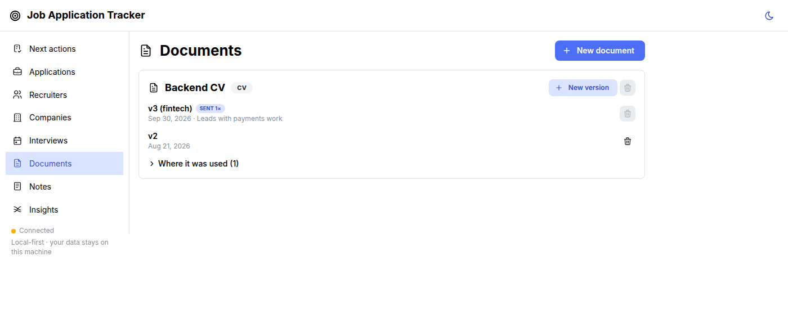</td>
<td width="50%"><b>Offers side by side</b>: a salary package against a contract day rate, worth-a-year first<br>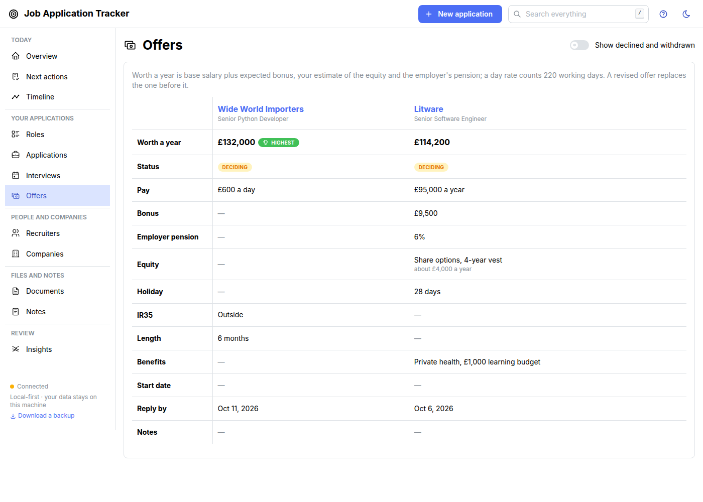</td>
</tr>
<tr>
<td width="50%"><b>Search everything</b> (press <kbd>/</kbd>): applications, people, notes, debriefs, calls, emails<br>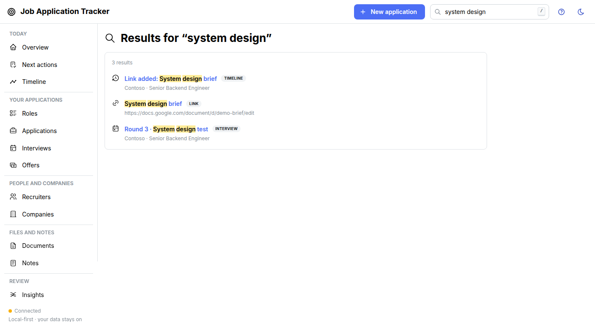</td>
<td width="50%"></td>
</tr>
</table>

</details>

## ✨ Features

Version 1.0: ready and in daily use for a real job search. See the [changelog](CHANGELOG.md),
the [releases](https://github.com/waddington/job-application-tracker/releases) and the
[user guide](docs/guide/README.md).

| | Feature |
|---|---|
| 📋 | **Applications list** with search (company, role, recruiter) and filters (stage, route, agency, "needs chasing", archived) |
| 🗂️ | **Kanban board**: drag applications between any stages, with the usual next stages highlighted |
| 🔁 | **Flexible workflow**: move from any stage to any stage (or switch on Jira-style allowed transitions), full timestamped history and undo |
| 🧑‍💼 | **Recruiter CRM**: agencies, recruiters, multiple contact details, every role they've sent |
| 🪪 | **People pages**: a page per person (agency recruiter, in-house recruiter, hiring manager…) with contact details, calls, the roles they've mentioned, notes and every application they're part of; one person per email address and LinkedIn profile, and **merge** two records of the same person in one click |
| 🗑️ | **Rename and delete** companies, roles, agencies, people and applications (or archive them) |
| ⚠️ | **Duplicate-submission warning**: know before two agencies put you forward for the same job |
| 📝 | **Markdown notes** on applications, companies, agencies and people, plus general notes: real `.md` files you can edit anywhere |
| 🔗 | **Links** on applications, companies and agencies: job ads, Google Docs, take-home repos, with icons and default titles |
| 📎 | **Files and emails**: drop PDFs, images or exported emails (`.eml`) on an application, role, company, agency or person; emails land on the timeline at the time they were sent |
| 📄 | **CV and cover-letter versions**: every tailored version with its file, which one each application got, and where each was used |
| 💻 | **Interview rounds and coding tasks**: numbered rounds in your own words ("Round 2 · System design test") shown on the board, plus times, interviewers, prep, debrief, questions asked and take-home briefs; reschedule one from its application page, quick view, Today or Interviews, and the timelines show each move's old and new time, who needed the change and why |
| 🏠 | **Today** (the home page): *Your move* (replies to read, offers to answer, how did it go?, to-dos, follow-ups, roles to decide), *Coming up* and *Waiting on them* (waiting to hear back, gone quiet), under the numbers and pipeline; a numbered *How it works* and **New application** on every page |
| 🕰️ | **Timeline** across everything: calls, pitched and passed roles, applications, interviews and offers, by day or as lanes (one row per role, person, company or agency), filtered by period, kind or who it's about; a **Timeline** button on each person, company and agency opens it filtered to them |
| 👀 | **At a glance** on every application: what needs attention (with how long it's been), what's coming up, and key dates as "3 weeks ago" |
| ✅ | **To-dos** in your own words ("they messaged me, reply"), on their own or about a person, company, agency, role or application, with an optional date; see them on Today and the page they're about, and tick them off (with undo) |
| 🤔 | **Roles to decide**: add the roles a recruiter mentions on a call, then apply (it makes the application, through them), mark it interested (tracked, not applied yet) or pass with a reason; each role has its own page with to-dos, notes, links and files (the job description, which carries over to the application) |
| 📞 | **Calls and meetings** with people, outside any one application: book a recruiter catch-up with an agenda, then note how it went; shows on Today and the Timeline |
| 📨 | **Waiting to hear back**: mark that you've replied and see who to chase; **They've replied** puts it at the top of Today; **Chased**, **Ghosted** or **Not interested** in one click, with a ghost by anyone who ghosted you; star favourite recruiters; see how many working days each person *usually* takes to reply |
| 😴 | **One-click chasing**: set a follow-up reminder, snooze, or mark Ghosted straight from Today |
| 📊 | **Sankey diagram** of your funnel: applications → screens → interviews → offers, filtered by date range and route, with counts on hover |
| 📈 | **Insights**: the whole picture (every role from where it came from to what's still waiting at each stage), conversion per stage, median time in stage, direct vs recruiter outcomes and weekly activity |
| 🗣️ | **Recruiter conversations** in Insights: calls held, roles pitched, applied or passed (with your reasons), where pitched roles went, time to decide, per person and per agency |
| 🧪 | **Which CV works best**: an A/B test of your CV and cover-letter versions (heard back, screens or interviews, offers, how sure each number is, and whether a gap is likely real); CV files attached to applications, roles or recruiters become versions in one click |
| 🏅 | **Recruiter scorecard**: roles sent, interview rate, where they ended up, time to first update and last contact, per recruiter and per agency |
| 💷 | **Offer comparison**: salary, bonus, equity, pension and holiday, or day rate, IR35 and length for contracts, side by side with a worth-a-year figure; replies due show on Today |
| 🔎 | **Search everything**: one box (press <kbd>/</kbd>) finds applications, people and their emails and phone numbers, interview debriefs, calls and meetings, offers, timeline entries, Markdown notes, CVs, files, emails and links |
| 💾 | **Backups built in**: automatic git snapshots of your private data folder, readable JSON Lines export, a one-click zip of everything (or `jat archive`), one-command restore |

The full plan is in the [product requirements](docs/prd/tracker.md) and the
[roadmap](docs/ROADMAP.yaml): next up are Windows support, a one-command install and Docker.

## 🤔 Why not a spreadsheet, Notion, Huntr or Teal?

| | Spreadsheet or Notion | Hosted trackers (Huntr, Teal, …) | **Job Application Tracker** |
|---|---|---|---|
| Your data stays on your machine | Sometimes | ❌ | ✅ |
| No account or sign-up | Depends | ❌ | ✅ |
| No AI features | Depends | ❌ | ✅ |
| No tracking or analytics | Depends | ❌ | ✅ |
| Works offline | Sometimes | ❌ | ✅ |
| Export you can read and diff | CSV | Partial | ✅ JSON Lines + Markdown, in git |
| Recruiters with several roles | Manual | Partial | ✅ First-class |
| Real stage workflow and history | ❌ | Partial | ✅ |
| Notes, files, emails and CV versions per application | Messy | Partial | ✅ |
| "Who do I chase today?" | ❌ | Partial | ✅ |
| Free and open source | ✅ | ❌ | ✅ Apache-2.0 |

## 🚀 Getting started

> 📖 **The [user guide](docs/guide/README.md)** covers everything below in more depth: where
> your data lives and how the app finds it, backups and restoring, using it on a second
> computer, customising stages, every command, and troubleshooting.

It runs on **Linux or macOS** (Windows isn't supported yet). You need Python 3.12+ with
[uv](https://docs.astral.sh/uv/), and Node.js 22.12+ with [pnpm](https://pnpm.io/) to build
the web UI. With those installed, setup takes about ten minutes.

```bash
git clone https://github.com/waddington/job-application-tracker.git
cd job-application-tracker
uv sync
pnpm --dir frontend install && pnpm --dir frontend build
```

**Try it with demo data** (made-up companies and people):

```bash
uv run python scripts/seed_demo.py /tmp/jat-demo    # needs a new or empty folder
uv run jat --data-dir /tmp/jat-demo serve          # → http://127.0.0.1:8770
```

**Use it for real.** Your data lives in its own folder, outside the code. Make it a private
git repo and the app commits a readable snapshot after each burst of changes, so you have
full history and backups for free.

```bash
mkdir -p ~/job-search-data && git -C ~/job-search-data init
git -C ~/job-search-data remote add origin <your-private-repo-url>   # optional, for jat push
cp .env.example .env        # then set JAT_DATA_DIR=~/job-search-data (or pass --data-dir each time)
uv run jat init
uv run jat serve            # → http://127.0.0.1:8770 (keeps running)
```

Later, from another terminal, `uv run jat push` sends the snapshots to your private remote
(never forced). Run `jat` from the repo root, where it reads `.env`. There's no settings
page for the data location: it's `--data-dir` or `JAT_DATA_DIR`
([details](docs/guide/your-data.md#how-the-app-finds-your-data)).

The server only listens on `127.0.0.1` by default. `uv run jat --help` lists the other
commands (`archive`, `export`, `restore`, `snapshot`, `migrate`, `info`).

## ❓ FAQ

**Is it free?** Yes. It's open source under the Apache-2.0 licence.

**Where is my data stored?** In a single directory on your own machine that you choose, kept
separate from the code. Nothing is uploaded anywhere.

**Does it use AI?** No. Nothing in it calls an AI service or sends your data anywhere.

**Does it run on Windows?** Not yet: it runs on Linux and macOS. Windows support, a
one-command install and Docker are on the [roadmap](docs/ROADMAP.yaml).

**Does it scrape LinkedIn or job boards?** No. By design, it tracks the applications you
make and doesn't search for jobs.

**Can I use it for non-software jobs?** Yes. It's built with tech hiring in mind (recruiters,
coding interviews, take-home tasks), but the stages are configurable
([Customising](docs/guide/customising.md)).

**What format is my data in?** A SQLite database for speed, plus a plain-text export
(one JSON Lines file per table) that's committed to your data repo. You can read it, diff it,
and rebuild the database from it with `jat restore`.

**How do I back it up?** It's automatic if the data folder is a git repo: every change is
snapshotted, and `jat push` sends it to your private remote. For a single file to keep
anywhere, click *Download a backup* in the sidebar (or run `jat archive`): a zip with your
data, notes and files. Unzip it and run `jat init` on the folder to get everything back.
See [Your data](docs/guide/your-data.md).

**Can I use it on two computers?** Yes, one at a time: clone your private data repo on the
second computer, point `JAT_DATA_DIR` at it and run `jat init`. When you switch, push on one,
then pull and `jat restore --force` on the other.
[Step by step](docs/guide/your-data.md#using-it-on-a-second-computer).

**Do I have to add the company and recruiter before an application?** No. Press **New
application** (top right, on every page) and type the company, role, agency and recruiter:
anything new is created for you. The **?** button walks through the everyday loop.

**A recruiter called about the market, not a specific role. Where does that go?** On their
page: **Book a call** (or log one that happened). Once it's marked *Happened*, **Add roles
from this call** for each
role they mentioned. Each waits under *Roles* until you decide: apply, mark interested or pass.

**Can I track which interview round I'm at?** Yes. Each application has numbered rounds
with your own description ("Round 2 · Engineering manager chat", "Round 3 · System design
test"), and the board shows the current one.

**Does it work offline?** Yes. It's a local web app with no external services; only
`jat push`, when you run it, talks to your own git remote.

**Is it multi-user?** No. It's a personal tool for one job seeker, running on localhost.

## 🤝 Contributing

Issues, ideas and PRs are welcome: [CONTRIBUTING.md](CONTRIBUTING.md) covers setting up for
development, the checks and the website. [Report a bug](https://github.com/waddington/job-application-tracker/issues/new?template=bug_report.yml)
or [suggest a feature](https://github.com/waddington/job-application-tracker/issues/new?template=feature_request.yml).
The roadmap in [`docs/ROADMAP.yaml`](docs/ROADMAP.yaml) shows what's next, and
[`docs/planning/README.md`](docs/planning/README.md) explains how work is planned. Please use
made-up data in issues, tests and screenshots.

If this looks useful, **⭐ star the repo**. It helps other job seekers find it.

## 📜 License

[Apache-2.0](LICENSE) © 2026 Kai Waddington. If you redistribute this project or build on
it, please keep the [NOTICE](NOTICE) file crediting the original author.
