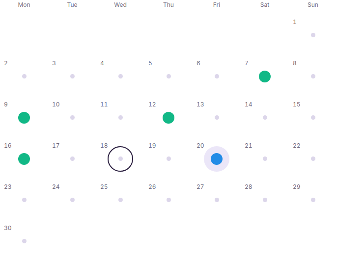
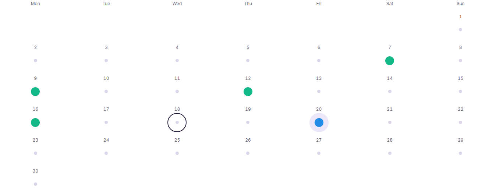

# How the calendar dots bug shipped, and how to stop the next one

A root-cause analysis of `fix-calendar-day-number-apart`. Written 2026-11-18. Findings for review, not a decision:
nothing here changes code or process until the owner picks from the recommendations at the end.

## Summary

- **What:** in the Interviews page's Month calendar, each day's number sat far to the left of that day's dot. On a
  wide screen the number looked like it belonged to the day before ("1" under Sat, its dot under Sun).
- **Introduced by:** #384 (`app-redesign-shell`, app redesign part 3), merged and released as v1.24.28 on
  2026-11-15 at 22:18 UTC.
- **Found by:** the owner, in the running app, on 2026-11-17 at about 17:35 UTC, about 43 hours later. No review,
  test or screenshot caught it. Six UI PRs merged in between (#387, #395, #396, #399, #401, #402) and none caught it
  either.
- **Fixed by:** #405 (v1.24.35, 2026-11-17 18:20 UTC). It also added the backlog task `calendar-ui-improve`. #404,
  which only recorded the bug on the roadmap, was closed and folded into #405.
- **Root cause in one line:** #384 removed the Interviews page's 1,100 px width cap. The calendar's CSS had always
  pinned each day's number to its cell's top-left corner while centring the dot, so wider cells pulled the two apart.
  Nothing else in #384 touched the calendar.

| Before #384 (page capped at 1,100 px) | After #384, at 2,048 px | After #405, at 2,048 px |
|---|---|---|
|  |  |  |

These are demo data (`scripts/seed_demo.py`), November 2026, light theme, 2,048 × 1,100 window. The first image is
the pre-fix CSS with the page capped back to 1,100 px by an injected style rule. That reproduces the old layout; it
isn't a build of the old commit.

## 1. Root cause in the code

### What the calendar did

The Month view arrived with #317 (`interviews-calendar`, merged 2026-11-12). Each day is a `.dotCell`: a flex box
that centres the dot (or the coloured round button) in the cell. The day's number is a separate absolutely
positioned span (`frontend/src/components/InterviewCalendar.module.css` before #405):

```css
.cellNumber {
  position: absolute;
  top: 2px;
  left: 8px;   /* pinned to the cell's corner, not to the dot */
  ...
}
```

The grid is `repeat(7, minmax(0, 1fr))`, so a cell is a seventh of the calendar's width, and the calendar is the
page's width minus the 340 px day panel and a 32 px gap. The gap between the number and its dot is therefore
roughly `cell width / 2 - 12 px`. **It grows with the page's width.** This coupling was there from #317 on. It
was harmless only because the page had a cap.

### What #384 changed

#384 replaced every page's own outer `<Stack maw={…}>` with a shared `Page` wrapper (`components/Page.tsx`,
`maw={2400}`). For `InterviewsPage.tsx` that changed `<Stack maw={1100}>` to `<Page>`, so the cap went from 1,100 px
to 2,400 px. Its PR body said "nothing inside the pages changes". That was true of the source, but not of the
layout: everything sized in `fr` or `%` inside the page got wider.

Measured on the demo with the pre-#405 CSS (Chrome, light, Month view, November 2026):

| Window | Page width | Cell width | Number to dot (horizontal, worst day) |
|---|---|---|---|
| Any width, 1,100 px cap (before #384) | 1,100 | 98 | 37 px |
| 1,400 (the browser tests' default) | 1,114 | 100 | 38 px |
| 1,440 (`tools/dev/shot.py`'s only desktop width) | 1,154 | 106 | 41 px |
| 2,048 | 1,762 | 193 | 84 px |
| 2,560 | 2,274 | 266 | 121 px |

At 1,400 and 1,440 px, the widths every test and every screenshot tool use, #384 changed the calendar by 1 to
4 px. The bug only shows from about 1,800 px up.

### What #384 did *not* do (ruled out)

I checked these because a global restyle is the usual suspect. None applies here:

- **No global CSS override hit the calendar.** #384's global CSS is the body, header and menu background
  (`Layout.module.css`), the menu's pill links, a `.pageTitle` class applied only to `h2` titles (`theme.ts`,
  `theme.module.css`), and a `--jat-surface` token. None of them selects anything inside the calendar.
- **No Mantine class names, `:has()` selectors or theme overrides are involved.** The calendar's cells are plain
  spans styled by its own CSS module. (`:has()` appears only in #405's new browser test, to find the cells.)
- **Demo data isn't a factor.** The demo seed puts interviews in the current month (5 interview days in November
  2026). Even with no interviews, every empty day has a small grey dot, so the gap shows on all 30 days.

### What #405 changed

- `.cellNumber` changed from `left: 8px` to `left: 0; right: 0; text-align: center`. The number is now centred over
  the dot at any width.
- `.month[data-large] .dotCell` gained `padding-top: 18px`, so the dot, today's ring and the chosen day's disc
  centre in the space below the number, and the ring never covers it.
- The phone rule's own `left: 4px` was removed, so the number is centred at phone width too.
- New browser test in `frontend/e2e/interviews-calendar.spec.ts`: "each day's number sits just above its own
  dot, however wide the screen". At 2,048, 1,440 and 375 px, for all 30 days of June 2030, it checks two things:
  the number's centre is within 3 px of its dot's, and the number sits above the dot. The PR says it failed on
  main at 2,048 px (84 px apart), which matches the measurement above.

With #405's CSS, the gap is 0 px at every width in the table above.

## 2. How it got merged and released unflagged

### What #384's review covered

- **The builder** was told to check light, dark, zh-CN, 2,560 px and phone width. It looked at Today at 2,560 px
  (dark), Today at 375 px, Today in zh-CN, an application page and Notes. It didn't look at Interviews at any
  width.
- **The screenshot table was dropped.** Partway through the build the lead told the builder to skip the
  before-and-after screenshot table (no `pr-shots/` branch). That afternoon the owner had said the redesign's PRs
  don't need the owner's screenshot approval: the reviews and checks are enough (`docs/agents/working-with-kai.md`,
  `docs/rfc/app-redesign.md` §3). The demo server stayed up for the reviewer.
- **The reviewer** was asked, among other things, to "look for any page missed or any inner layout broken". The
  example it was given was pages that relied on their narrow cap *for readability* (forms, long text). It:
  - took Today at 375, 800, 1,000 and 1,400 px, and a dark Applications page;
  - wrote a script that screenshotted eight routes at 2,560 px, `/interviews` among them (`w-interviews.png`);
  - **opened only some of them**: Notes, a role, Search, Documents, Timeline and a modal. It never opened
    `w-interviews.png` (checked against the reviewer's transcript: no `Read` of that file);
  - found the readability problem (notes running about 2,190 px per line) and the Documents delete button far from
    its row. Both were fixed, and a re-review checked only those fixes, again on Notes and Documents.
- **The lead** merged after the re-review and full checks, then reported the release. It didn't open the app or a
  screenshot after the merge.

So the one image that showed the bug was taken and never looked at. The review prompt pointed at *text*
readability, and the reviewer found exactly that class of problem and stopped there.

### What the browser tests assert, and why none caught it

- `frontend/playwright.config.ts` runs every test at **1,400 × 1,000** unless a test says otherwise. At 1,400 px,
  the Interviews page is 1,114 px wide: within 14 px of the old cap. The calendar at the default width barely
  changed.
- Before #405, `interviews-calendar.spec.ts` asserted behaviour: which month shows, choosing a day fills the panel,
  focus, the Year view's twelve months and figures, and at 375 px no sideways scroll and the panel's position. No
  test measured where a day's number sits relative to its dot, at any width.
- #384's own new tests (`shell.spec.ts`, "the page's width") checked the wrapper: it fills the width at 1,400 px
  and stops at 2,400 px on a 3,000 px window for Today, Notes and Insights. They tested the container's width, not
  what the wider container did to the pages inside it.
- Only two specs used a wide window: `board.spec.ts` at 3,800 px (so every column fits) and `shell.spec.ts` at
  3,000 px. There are no screenshot comparisons anywhere (`toHaveScreenshot` isn't used).
- The RFC's §7 "Browser tests at risk" lists the tests the redesign might *break*. It doesn't ask for tests of
  layouts the redesign might break without breaking a test.

### Was the calendar looked at after #384?

Yes, but only at 1,440 px, where it looked the same as before #384 (41 px vs 37 px):

- #396 (page skeletons): the reviewer measured layout shift on the Interviews calendar at 1,440 × 1,000.
- #402 (`app-redesign-components`): the builder took `/interviews@light` with `tools/dev/shot.py`, whose desktop
  width is fixed at 1,440 px, and the reviewer opened `interviews-light-1440.png`. #402 also edited
  `InterviewCalendar.tsx` (the figures' bar became segmented) without touching the day numbers.
- In #387, #395, #399 and #401 no builder or reviewer opened a screenshot of Interviews.

Nobody looked at Interviews above 1,440 px until the owner did. When the lead reproduced the bug, its first note
was that the screenshot helper only supports 1,440 and 375 px, so it wrote a one-off script for 2,048 px.

## 3. Contributing factors

### Five whys

1. *Why were the numbers far from their dots?* The number was pinned to the cell's corner and the dot centred, and
   the cells got about twice as wide.
2. *Why did the cells get wider?* #384 deliberately raised every page's cap to 2,400 px. The calendar's layout
   depended on the old 1,100 px cap, and nobody had written that down.
3. *Why didn't the PR see that?* Its model of the change was "the wrapper changes, nothing inside does". Its tests
   and its review prompt checked the wrapper and text readability. They didn't check every page's inner layout at
   the new widths.
4. *Why didn't the review see it?* The reviewer's 2,560 px screenshot of Interviews was taken but never opened.
   Every other look at Interviews, then and later, was at 1,440 px, the only desktop width `shot.py` offers and close
   to the test default, where the change is invisible.
5. *Why did nothing else catch it?* There's no visual regression testing and no wide-window layout test. The owner
   no longer saw screenshots of redesign PRs before merge, and there was no post-merge look at wide pages. The first
   wide-screen eyes on it were the owner's, in daily use.

### Fishbone

| Area | Factor | Checked? |
|---|---|---|
| **Code** | Day number positioned relative to the cell's corner, not to the dot: a latent coupling to cell width since #317 | Yes: CSS above |
| **Code** | A shared constraint (the page cap) changed for 19 pages at once, with "nothing inside the pages changes" as the stated assumption | Yes: #384 body and diff |
| **Code** | *Global CSS / Mantine overrides leaking into the page* | **Ruled out**: no #384 selector reaches the calendar |
| **Tests** | Browser tests' default 1,400 px ≈ the old 1,100 px cap, so the default width couldn't show it | Yes: measured 1,114 vs 1,100 |
| **Tests** | No geometry assertion for the calendar; wide-window specs only for the board and the shell | Yes: specs read |
| **Tests** | No screenshot baselines (`toHaveScreenshot` unused) | Yes: grep |
| **Tools** | `tools/dev/shot.py` has two widths only: 1,440 and 375 | Yes: `shot.py` line 19 |
| **Review** | Prompt named readability, and the reviewer found that class of problem and stopped | Yes: transcript |
| **Review** | The wide Interviews screenshot was taken but not opened | Yes: reviewer transcript, no `Read` of it |
| **Review** | Re-review covered only the fix commits | Yes: by design of the cycle |
| **Review** | Later PRs' reviewers looked at their own diff's pages, at 1,440 px | Yes: #396, #402 |
| **Process** | Owner's screenshot approval dropped for redesign PRs; no before/after table | Yes: working-with-kai.md, RFC §3 |
| **Process** | No post-merge look at the app by the lead | Yes: no screenshot opened between the #384 merge and the report |
| **Data** | *Demo data lacks interviews in the visible month* | **Ruled out**: 5 interview days in the demo month, and empty days show the bug too |

## 4. Prevention ideas

"Run time" is on the owner's PC, under the existing limits (`pnpm e2e` uses half the CPU threads at low priority and
waits for other worktrees; CLAUDE.md, *Don't max out Kai's PC*). The full browser suite took 4.8 minutes for 755
tests on #384's final commit.

### A. `shot.py` takes any width, and a route sweep for layout PRs

**What:** let `tools/dev/shot.py` take `@<width>` (e.g. `@2048`, `@2560`) as well as `@375`, and add a
`--sweep` mode. The sweep shoots every top-level route plus one of each record page, at 375, 1,440 and 2,560 px,
light. It writes one contact sheet per width: a single image with every route as a labelled thumbnail.

- **Would it have caught this?** Yes, if the sheet is looked at. At 2,560 px the calendar's numbers sit 121 px from
  their dots, which is obvious even in a thumbnail. It also fixes the reason the lead had to write a one-off script.
- **Pros:** cheap; reuses the demo server every UI PR already runs; one image to look at instead of 20; useful
  for builders, reviewers and post-merge checks.
- **Cons:** someone still has to look. A contact sheet makes that one image, not twenty, but it doesn't make it
  happen (see B).
- **Cost:** about 1 to 2 hours to build. Run time about 1 to 2 minutes: one headless Chrome, one page at a time,
  about 60 screenshots. Light on the PC (one browser process, no workers).
- **Maintenance:** low. The route list can come from `frontend/src/nav.ts` plus a few record pages looked up by
  name on the demo, as `scripts/i18n/translate/screenshots.py` already does.
- **Flakiness:** none (it asserts nothing). The demo's dates move with the clock, so images differ day to day; that
  doesn't matter for eyeballing.
- **Recommendation:** **do it.** Highest value for the cost.

### B. A blast-radius rule for shared-layout changes, with a per-route verdict in the review

**What:** a PR that changes a shared constraint lists in its body every page that consumes it. Shared constraints
are things like the page wrapper or its cap, `Layout.tsx`, the theme's spacing or type scale, `tokens.css`, or
Mantine component defaults in `theme.ts`. The review brief for such a PR then says: run the sweep (A) at every
width, open each sheet, and return one line per route ("Interviews, 2,560: OK / problem"). "Nothing inside the
pages changes" isn't accepted as a claim without that table. It goes in `CONTRIBUTING.md`, the redesign RFC's §3,
and a reviewer brief in `tools/dev/briefs/`.

- **Would it have caught this?** Very likely. #384's reviewer had the Interviews screenshot in hand; a required
  verdict line for it would have forced opening it.
- **Pros:** costs nothing to run; targets exactly the PRs where a global change hits page-specific layouts; makes
  "taken but not looked at" visible.
- **Cons:** depends on discipline (agents follow briefs well, but the brief must be used); adds a few minutes to
  each such review; a route list in a brief can go stale (generating it, as in A, avoids that).
- **Cost:** about 30 minutes of writing. No run time beyond A.
- **Maintenance:** low.
- **Flakiness:** n/a.
- **Recommendation:** **do it, together with A.** Most of the redesign's remaining parts (dock, Today, records,
  schedule, phone nav) are exactly this kind of PR.

### C. Layout geometry tests at wide widths

**What:** browser tests that measure layout invariants with `getBoundingClientRect`, run at more than the default
1,400 px. #405's calendar test is the model: number above its dot and centred within 3 px, at 2,048, 1,440 and
375 px. Extend the idea to the other places where a label and its mark are laid out apart and could drift:
- the board's column headers over their columns;
- Today's pipeline key dots beside their bars;
- the calendar's figures and their key;
- the Timeline's lanes and their labels.

Tag them `@layout` and run them at 2,560 px as well (a Playwright project, or a loop over widths as #405 does).

- **Would it have caught this?** Yes, *if the calendar test had existed before #384*. It would have failed at
  2,048 px. That is the catch: geometry tests protect what someone already thought to protect. They don't find new
  kinds of breakage.
- **Pros:** precise, deterministic, fast, no images to store or review; failures say exactly what's wrong ("day 1
  at 2,048 px: 84 px apart").
- **Cons:** one test per invariant; you only write them for layouts you suspect; brittle if the DOM structure
  changes (the calendar test finds cells by `span:has(> span + *)`).
- **Cost:** about 1 hour per component. Run time: a few seconds each; a wide-window project for a handful of
  tagged specs adds well under 30 s.
- **Maintenance:** low to medium (selectors move when components are restyled).
- **Flakiness:** low. Fixed clocks and the tests' own data; tolerances in px rather than exact values.
- **Recommendation:** **do it for the 3 or 4 components above**, and make "a layout test at 375 and 2,560 px" part
  of any new component that positions things relative to its container.

### D. Screenshot baselines (`toHaveScreenshot`) for key pages

**What:** Playwright visual regression. For about 8 key pages (Today, Applications list and board, an application,
Interviews Month, Timeline, Insights, Notes) at 1,400 and 2,560 px, light, compare against committed baseline PNGs.
It needs fixed data and a fixed clock (the e2e fixtures already pin the clock and make their own records), reduced
motion (already the default, which also stops the drifting background), and masks for anything time-dependent.

- **Would it have caught this?** Only partly. #384 changed *every* page on purpose (background, titles, menu,
  width), so every baseline would have failed and been regenerated in the same PR. The calendar change would have
  been one image among about 16 updated ones. It would only have been caught if someone opened the 2,560 px
  Interviews diff and judged it, which is the same human step that failed here. Baselines are strongest for PRs
  that *shouldn't* change a page's look; for those they catch drift no one thought to test.
- **Pros:** catches unanticipated visual changes on PRs not meant to change looks (most PRs); the diff images show
  exactly where.
- **Cons:** high churn during the redesign (each of the remaining parts re-baselines most pages); baseline PNGs in
  the repo (perhaps 2 to 4 MB, and growing with every re-baseline); font rendering differs by platform, so the
  Windows VM would need its own set or skip them.
- **Cost:** half a day to set up well (data, masks, a script to update baselines). Run time about 30 to 60 s added
  to `pnpm e2e` for 16 screenshots, within the existing worker limits.
- **Maintenance:** medium to high while the redesign is in progress, low after.
- **Flakiness:** medium. Anti-aliasing, font loading, skeleton timing and Mantine transitions all need care; a
  small pixel tolerance helps.
- **Recommendation:** **wait until the redesign's layout parts have landed**, then add a small set. Until then A+B
  give most of the benefit without the churn.

### E. A post-merge wide-screen look by the lead

**What:** after merging a UI PR, the lead runs the sweep (A) against a demo server built from main (not the owner's
tracker on 8770) at the widths the owner actually uses. It compares the sheets with the previous release's, if
kept, and records a one-line verdict in `var/RESUME.md`. CLAUDE.md already says to "try the change for real" after
a merge; this makes it concrete for UI changes.

- **Would it have caught this?** Probably, a day and a half before the owner did. It is after release, though, so
  it shortens the bug's life rather than preventing it.
- **Pros:** a second, independent look by someone who didn't build or review the PR; catches what a PR's own
  review scoped out.
- **Cons:** after the fact; another step on every UI merge; duplicates B if B is done well.
- **Cost:** a few minutes per UI merge; same light run time as A.
- **Maintenance:** low.
- **Flakiness:** n/a.
- **Recommendation:** **do it for redesign PRs**, as a cheap backstop while the owner isn't approving screenshots.

### F. Before-and-after screenshots in the PR again (for shared-layout PRs only)

**What:** bring back the `| Item | Before | After |` table on a `pr-shots/` branch, at the widths in A. It would be
for the reviewer, not for the owner's approval, so it keeps the owner's 2026-11-15 instruction that redesign PRs
merge on review alone.

- **Would it have caught this?** Only if Interviews at a wide width was in the table and someone compared the two.
  #384's builder looked at Today, an application page and Notes, and would likely have picked the same pages.
- **Pros:** a durable record in the PR; side-by-side makes changes obvious.
- **Cons:** more work per PR; the page choice is the builder's, which is the gap here; mostly duplicates A+B.
- **Cost:** about 15 to 30 minutes per PR.
- **Maintenance:** low.
- **Flakiness:** n/a.
- **Recommendation:** **optional.** Prefer A+B's full sweep to a hand-picked table.

### G. CSS guideline: position things relative to what they belong to, and test containers at their extremes

**What:** a short rule in `CONTRIBUTING.md`: inside a cell whose size depends on the page, anchor labels to the
thing they label (centre them over it, or put both in one flex group). Don't anchor them to the cell's corner. When
a component's layout depends on its container's width, consider a container query. Check it at the narrowest and
widest container it can get (375 px and the 2,400 px cap).

- **Would it have caught this?** It would likely have prevented it in #317, when the calendar was built. It doesn't
  catch anything by itself.
- **Pros:** removes the class of bug at the source; free.
- **Cons:** guidance, not enforcement; existing code isn't audited by it.
- **Cost:** 15 minutes to write. A one-off audit of other components with `position: absolute` plus a `left` or
  `right` in px inside grid or flex cells would take about an hour.
- **Maintenance:** none.
- **Flakiness:** n/a.
- **Recommendation:** **do the guideline**; do the audit when C is written, since they look at the same places.

### H. Ideas considered and not recommended

- **Scoping redesign CSS away from global Mantine overrides.** Good hygiene in general (`docs/agents/gotchas.md`
  already warns about guessing Mantine class selectors), but **not the cause here**: the break came from an
  intended width change, not a leaking selector. It wouldn't have caught this.
- **An accessibility or layout lint** (axe, Stylelint). Axe checks roles, names and contrast, not whether a label
  is near what it labels. A Stylelint rule against `position: absolute` with `left` in px would be noisy and easy
  to justify away. Neither would have caught this.
- **Seeding demo data that exercises the calendar.** Already true: the demo month has 5 interview days, and the bug
  shows on empty days too. No change needed.

## 5. Ranked recommendation

1. **A: `shot.py` any width plus a route sweep with contact sheets.** Cheap, light on the PC, and it removes the
   1,440 px blind spot that hid this bug from every later look.
2. **B: blast-radius rule plus a one-line verdict per route and width** in reviews of shared-layout PRs. It closes
   the "screenshot taken, never opened" gap that let this one through.
3. **C: geometry tests at 375 and 2,560 px** for the 3 or 4 label-and-mark components, tagged and run at wide
   widths. Deterministic protection for the layouts we now know are fragile.
4. **E: post-merge wide-screen sweep by the lead** for redesign PRs. A backstop while the owner isn't approving
   screenshots.
5. **G: the "anchor labels to their marks" CSS guideline**, with the audit folded into C.
6. **D: screenshot baselines**, after the redesign's layout parts land, for a small set of key pages.
7. **F: before-and-after tables**: optional, mostly covered by A+B.

Not recommended: scoping CSS away from Mantine overrides (not the cause), an a11y or layout lint (wouldn't catch
this), and demo-data changes (not needed).

## Sources

- PRs: #317 (the calendar), #384 (body, diff, review), #404 (closed), #405 (fix and test), and #387, #395, #396,
  #399, #401 and #402 between them.
- Code: `frontend/src/components/InterviewCalendar.module.css` at `9c923cf7^1` and at `main`;
  `frontend/src/components/Page.tsx`; `frontend/src/pages/InterviewsPage.tsx` before and after #384;
  `frontend/e2e/interviews-calendar.spec.ts`, `shell.spec.ts`, `board.spec.ts`; `frontend/playwright.config.ts`;
  `tools/dev/shot.py`.
- Process: `docs/agents/working-with-kai.md` (screenshot approval for redesign PRs), `docs/rfc/app-redesign.md`
  §3, §4 row 2 and §7.
- The maintainer's session transcripts for the build, review and re-review of #384, the reviews of #396 and #402,
  and the bug report and fix (2026-11-15 to 2026-11-17). They were searched for screenshots opened, not quoted.
- Measurements: a demo server from this branch on demo data, with the pre-#405 CSS and then the current CSS, at
  1,400, 1,440, 2,048 and 2,560 px.
